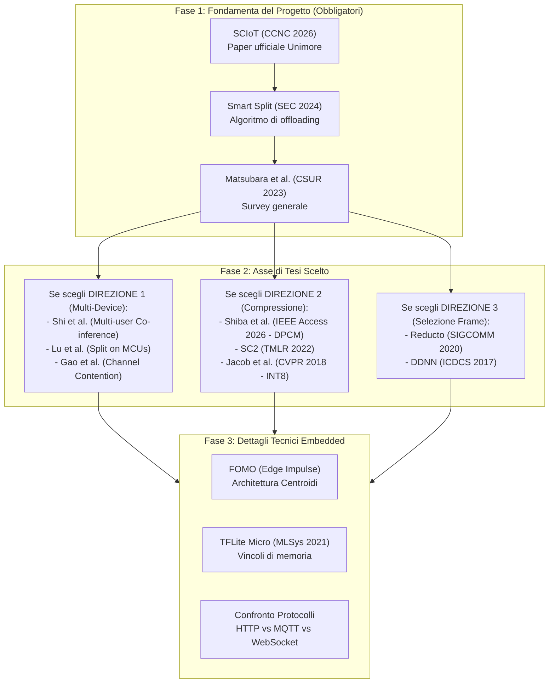

# SCIoT — Rassegna della Letteratura Scientifica e Paper di Riferimento

Documento creato il 18 ottobre 2026 come guida allo studio bibliografico per il tirocinio e la tesi triennale su **Multi Device Split Computing** nell'ambito del framework **SCIoT** (Università di Modena e Reggio Emilia, relatore Prof. Luca Bedogni).

Questo documento raccoglie, categorizza e analizza i paper scientifici fondamentali, collegando ciascun lavoro direttamente all'architettura del repository, alle sperimentazioni in corso e ai potenziali argomenti di tesi descritti in [POSSIBILI_ARGOMENTI_TESI.md](POSSIBILI_ARGOMENTI_TESI.md).

---

## Indice dei Contenuti

1. [Come Utilizzare Questa Rassegna](#come-utilizzare-questa-rassegna)
2. [I Paper Fondamentali del Laboratorio (Unimore / UBICO)](#1-i-paper-fondamentali-del-laboratorio-unimore--ubico)
3. [Survey Generali e Lavori Pionieristici sullo Split Computing](#2-survey-generali-e-lavori-pionieristici-sullo-split-computing)
4. [Direzione 1: Multi-Device, Concorrenza, Accodamento e Carico del Server](#3-direzione-1-multi-device-concorrenza-accodamento-e-carico-del-server)
5. [Direzione 2: Compressione delle Attivazioni e Ridondanza Temporale (DPCM)](#4-direzione-2-compressione-delle-attivazioni-e-ridondanza-temporale-dpcm)
6. [Direzione 3: Selezione dei Frame ed Early Exiting (Video Analytics)](#5-direzione-3-selezione-dei-frame-ed-early-exiting-video-analytics)
7. [Direzione 4: Grafi Complessi e Reti con Connessioni Residue (DAG)](#6-direzione-4-grafi-complessi-e-reti-con-connessioni-residue-dag)
8. [Architettura del Modello e Runtime Embedded: FOMO, INT8 e TinyML](#7-architettura-del-modello-e-runtime-embedded-fomo-int8-e-tinyml)
9. [Protocolli di Trasporto di Rete: MQTT vs WebSocket vs HTTP vs ESP-NOW](#8-protocolli-di-trasporto-di-rete-mqtt-vs-websocket-vs-http-vs-esp-now)
10. [Piano di Studio Consigliato (Ordine di Lettura)](#piano-di-studio-consigliato-ordine-di-lettura)

---

## Come Utilizzare Questa Rassegna

Ogni scheda contiene:
* **Riferimento bibliografico completo** (autori, titolo, conferenza/rivista, anno, DOI/link).
* **Contributo scientifico in sintesi** (cosa ha introdotto il paper).
* **Collegamento con SCIoT** (dove e come impatta il codice del repository).
* **Cosa estrarre per la tesi** (idee, formule, grafici o protocolli sperimentali utili).

---

## 1. I Paper Fondamentali del Laboratorio (Unimore / UBICO)

Questi sono i paper scritti dal gruppo di ricerca con cui svolgi la tesi. Costituiscono la base teorica del software SCIoT e sono riferimenti imprescindibili per il capitolo introduttivo.

### 1.1 Il Paper Ufficiale di SCIoT
* **Riferimento:** L. Lamazzi, J. W. Wang, F. Franco, L. Bedogni, *"SCIoT: Design and Evaluation of a Split Computing Framework for Collaborative Inference in the IoT"*, IEEE 23rd Consumer Communications & Networking Conference (CCNC), 2026.
* **Link:** [IRIS UNIMORE: 11380/1401417](https://iris.unimore.it/handle/11380/1401417)
* **Contributo:** Presenta formalmente il framework SCIoT, la separazione tra Edge Server e nodi IoT (ESP32), l'integrazione con modelli esportati da Edge Impulse e la valutazione iniziale di latenza ed energia.
* **Collegamento con SCIoT:** È il paper che descrive esattamente questo repository (`src/server/`, `src/client/`).
* **Cosa estrarre per la tesi:** Lo schema architetturale di base, le assunzioni sul partizionamento e le limitazioni dichiarate che la tua tesi andrà ad affrontare.

### 1.2 Prestazioni di Split Computing su Dispositivi IoT
* **Riferimento:** F. Bove, S. Colli, L. Bedogni, *"Performance Evaluation of Split Computing with TinyML on IoT Devices"*, 2024 IEEE 21st Consumer Communications & Networking Conference (CCNC), pp. 1-6, 2024.
* **Link:** [DOI: 10.1109/CCNC51664.2024.10454775](http://dx.doi.org/10.1109/CCNC51664.2024.10454775)
* **Contributo:** Valutazione quantitativa delle prestazioni dell'inferenza partizionata su microcontroller a bassissimo consumo energetico confrontata con l'inferenza puramente locale o puramente su cloud.
* **Collegamento con SCIoT:** Fornisce i parametri di profilazione temporale ed energetica di base per ESP32 utilizzati da [src/server/commons.py](src/server/commons.py).
* **Cosa estrarre per la tesi:** La curva di latenza vs split layer su reti Wi-Fi e la dimostrazione del collo di bottiglia di memoria su MCU.

### 1.3 Smart Split per Edge AI Efficiente
* **Riferimento:** F. Bove, L. Bedogni, *"Smart Split: Leveraging TinyML and Split Computing for Efficient Edge AI"*, 2024 IEEE/ACM Symposium on Edge Computing (SEC), pp. 456-460, 2024.
* **Link:** [DOI: 10.1109/SEC62691.2024.00052](http://dx.doi.org/10.1109/SEC62691.2024.00052)
* **Contributo:** Estensione dinamica per la scelta dello split point in condizioni di rete fluttuanti, bilanciando il vincolo energetico locale e il throughput disponibile.
* **Collegamento con SCIoT:** L'algoritmo euristico implementato in [src/server/offloading_algo/offloading_algo.py](src/server/offloading_algo/offloading_algo.py).
* **Cosa estrarre per la tesi:** La formulazione matematica della funzione di costo attuale: $T_{total} = T_{device} + T_{tx} + T_{server}$.

---

## 2. Survey Generali e Lavori Pionieristici sullo Split Computing

### 2.1 Il Survey Completo su Split Computing ed Early Exiting
* **Riferimento:** Y. Matsubara, M. Levorato, F. Restuccia, *"Split Computing and Early Exiting for Deep Learning Applications: Survey and Research Challenges"*, ACM Computing Surveys (CSUR), Vol. 55, No. 5, 2023.
* **Link:** [arXiv:2103.04504](https://arxiv.org/abs/2103.04504)
* **Contributo:** La rassegna più esaustiva della letteratura scientifica sul tema. Classifica le tecniche di splitting (statico, dinamico, adattivo), la compressione di feature (lossless, lossy con bottleneck), le problematiche di privacy e le sfide aperte di latenza ed energia.
* **Collegamento con SCIoT:** Fornisce l'inquadramento bibliografico e tassonomico per l'intero capitolo di *Stato dell'Arte* della tesi.
* **Cosa estrarre per la tesi:** La tassonomia delle tecniche di compressione dei tensori intermedi e la rassegna dei colli di bottiglia nei layer convoluzionali.

### 2.2 Neurosurgeon: Il Paper Capostipite
* **Riferimento:** Y. Kang et al., *"Neurosurgeon: Collaborative Intelligence Between the Cloud and Mobile Edge"*, ACM ASPLOS 2017.
* **Link:** [ACM Digital Library](https://dl.acm.org/doi/10.1145/3037697.3037698)
* **Contributo:** Il primo sistema automatico capace di profilare una rete neurale layer per layer e decidere dinamicamente il punto di partizionamento ottimale tra dispositivo mobile e cloud server.
* **Collegamento con SCIoT:** Ha introdotto il principio di regressione lineare per stimare i tempi di calcolo dei layer e la dipendenza dalle dimensioni del tensore di split.
* **Cosa estrarre per la tesi:** La dimostrazione che i primi layer aumentano spesso la dimensione dei dati rispetto all'input grezzo ("data expansion"), rendendo critici solo i punti di collo di bottiglia ("bottleneck layers").

---

## 3. Direzione 1: Multi-Device, Concorrenza, Accodamento e Carico del Server

Questa direzione corrisponde alla prima proposta in [POSSIBILI_ARGOMENTI_TESI.md](POSSIBILI_ARGOMENTI_TESI.md) ed è direttamente legata al titolo concordato **"Multi Device Split Computing"**.

### 3.1 Multi-user Co-inference con Batch Processing
* **Riferimento:** W. Shi, S. Zhou, Z. Niu (Tsinghua University), *"Multi-user Co-inference with Batch Processing Capable Edge Server"*, arXiv:2108.06899 (presentato anche in IEEE Transactions).
* **Link:** [arXiv:2108.06899](https://arxiv.org/abs/2108.06899)
* **Contributo:** Modella formalmente l'offloading concorrente di più utenti verso un server edge dotato di GPU/CPU capace di elaborare in batch. Dimostra come i tempi di accodamento (*queuing delay*) alterino il punto di split ottimale rispetto al caso a singolo utente.
* **Collegamento con SCIoT:** L'algoritmo attuale di SCIoT ([offloading_algo.py](src/server/offloading_algo/offloading_algo.py)) assume un unico client. Questo paper fornisce la base per aggiungere il tempo di coda:
  $$T_{client\_i} = T_{dev, i}(k_i) + T_{tx, i}(k_i) + T_{queue}(carico) + T_{srv}(k_i)$$
* **Cosa estrarre per la tesi:** Il trade-off tra latenza del singolo client e throughput aggregato del server, e la politica di raggruppamento delle richieste.

### 3.2 Schedulazione e Batching per Arrivi Asincroni Multi-Utente
* **Riferimento:** *"Joint Batching and Scheduling for High-Throughput Multiuser Edge AI with Asynchronous Task Arrivals"*, IEEE VTC / arXiv.
* **Link:** [arXiv:2404.14812](https://arxiv.org/abs/2404.14812)
* **Contributo:** Gestione di task che arrivano da diversi client a intervalli stocastici, definendo finestre temporali di batching senza sforare le scadenze (*deadline*).
* **Collegamento con SCIoT:** Perfetto per modellare scenari con 2, 4 o più ESP32 che catturano frame a frequenze diverse o asincrone.
* **Cosa estrarre per la tesi:** Metriche di valutazione: percentile 95 e 99 della latenza, percentuale di deadline mancate e overhead di sincronizzazione.

### 3.3 Split Inference su Reti di Microcontroller
* **Riferimento:** J. Lu et al., *"Split CNN Inference on Networked Microcontrollers"*, IEEE WoWMoM 2026 / arXiv:2605.09357.
* **Link:** [arXiv:2605.09357](https://arxiv.org/abs/2605.09357)
* **Contributo:** Sistema di split inference cooperativo tra molteplici microcontroller interconnessi a livello embedded, affrontando i vincoli di SRAM limitata tramite partizionamento sub-layer coordinato dinamicamente.
* **Collegamento con SCIoT:** Dimostra la fattibilità sperimentale di coordinare MCU reali con risorse strettissime.
* **Cosa estrarre per la tesi:** Metodologia di benchmarking della memoria (SRAM vs Flash) e stabilità prolungata delle connessioni embedded.

### 3.4 Contesa del Canale Wireless in Reti IoT Multi-Device
* **Riferimento:** L. Gao et al., *"Co-Inference of Deep Neural Networks over Wireless IoT Networks with Channel Contention"*, IEEE Transactions on Mobile Computing (TMC).
* **Contributo:** Analisi dell'impatto del protocollo MAC 802.11 (CSMA/CA) quando più dispositivi IoT trasmettono attivazioni simultaneamente: la contesa del mezzo e i meccanismi di backoff provocano collisioni e code a livello radio.
* **Collegamento con SCIoT:** Se 4 ESP32 inviano contemporaneamente tensori al server via Wi-Fi, la latenza di rete esplode a causa della contesa fisica, non solo del server Python.
* **Cosa estrarre per la tesi:** La spiegazione teorica del perché la latenza reale su banco di prova Wi-Fi multi-device è superiore a quella simulata su loopback.

---

## 4. Direzione 2: Compressione delle Attivazioni e Ridondanza Temporale (DPCM)

Questa direzione corrisponde alla seconda proposta in [POSSIBILI_ARGOMENTI_TESI.md](POSSIBILI_ARGOMENTI_TESI.md) e agli esperimenti documentati in [ANALISI_COMPRESSIONE_ATTIVAZIONI.md](ANALISI_COMPRESSIONE_ATTIVAZIONI.md).

### 4.1 Delta Coding con Dead-Zone Quantization
* **Riferimento:** T. Shiba et al., *"Delta Coding With Dead-Zone Quantization for Bandwidth-Efficient Split Computing on Video Streams"*, IEEE Access, Vol. 12, pp. 36904-36916, 2026.
* **Link:** [DOI: 10.1109/ACCESS.2026.3690477](https://doi.org/10.1109/ACCESS.2026.3690477) | [PDF Unikobe](https://da.lib.kobe-u.ac.jp/da/kernel/0100504251/0100504251.pdf)
* **Contributo:** Codifica differenziale (DPCM) delle attivazioni tra frame video consecutivi. Introduce una *dead-zone* (zona morta) nella quantizzazione uniforme che mappa a zero tutte le variazioni al di sotto di una certa ampiezza, incrementando drasticamente la comprimibilità entropica (zlib) senza degradare l'accuratezza top-1.
* **Collegamento con SCIoT:** È il riferimento cardine per il confronto programmato nella Sezione 9.3 e 9.4 di [ANALISI_COMPRESSIONE_ATTIVAZIONI.md](ANALISI_COMPRESSIONE_ATTIVAZIONI.md).
* **Cosa estrarre per la tesi:** Lo schema matematico di quantizzazione del residuo:
  $$e_t = x_t - \hat{x}_{t-1}, \quad q_t = Q_{DZ}(e_t, \Delta, \zeta), \quad \hat{x}_t = \hat{x}_{t-1} + Q^{-1}(q_t)$$
  e la distinzione tra modello teorico DnD e DPCM reale.

### 4.2 Supervised Compression for Split Computing (SC2)
* **Riferimento:** Y. Matsubara, D. Callegaro, S. Singh, M. Levorato, *"SC2: Supervised Compression for Split Computing"*, Transactions on Machine Learning Research (TMLR), 2022.
* **Link:** [arXiv:2203.08875](https://arxiv.org/abs/2203.08875) | [GitHub SC2-Benchmark](https://github.com/yoshitomo-matsubara/sc2-benchmark)
* **Contributo:** Stabilisce formalmente che la compressione per la visione artificiale (*machine vision*) segue regole di rate-distortion diverse dalla compressione per la percezione umana (JPEG/H.264). Fornisce un framework standard per quantificare byte vs accuratezza del task.
* **Collegamento con SCIoT:** Aiuta a strutturare il protocollo di test: misurare l'IoU e le detection corrette su video annotati, non solo l'errore quadratico medio (MSE) o la dimensione zlib.
* **Cosa estrarre per la tesi:** La metodologia sperimentale e le metriche di accuratezza per compiti di object detection.

### 4.3 BottleNet++: End-to-End Feature Compression
* **Riferimento:** J. Shao, J. Zhang, *"BottleNet++: An End-to-End Approach for Feature Compression in Collaborative Inference"*, IEEE INFOCOM 2020 / IEEE JSAC.
* **Link:** [arXiv:2003.02985](https://arxiv.org/abs/2003.02985)
* **Contributo:** Architettura end-to-end con layer di bottleneck leggeri che integrano Joint Source-Channel Coding (JSCC), rendendo la trasmissione dei tensori resiliente al rumore di canale e riducendo il payload fino a 64×.
* **Collegamento con SCIoT:** Mostra il limite superiore delle tecniche lossy quando è possibile inserire layer dedicati di bottleneck.
* **Cosa estrarre per la tesi:** Confronto teorico tra compressione addestrata (BottleNet) e compressione post-hoc a pesi fissati (come quella attuata in SCIoT su FOMO).

### 4.4 Vector Quantized Bottleneck in Split Inference
* **Riferimento:** *"Enhancing Latency-Accuracy Tradeoff in Dynamic Split Inference via Vector Quantized Bottleneck"*, IEEE Globecom Workshops, 2023.
* **Link:** [IEEE Xplore](https://ieeexplore.ieee.org/document/10437430)
* **Contributo:** Utilizzo della quantizzazione vettoriale (codebook di vettori di attivazione) al confine di split, permettendo di trasmettere solo gli indici del codebook anziché tensori float completi.
* **Collegamento con SCIoT:** Alternativa alla quantizzazione scalare uniforme testata in [experiments/activation_compression/lossy_2026-10-17/](experiments/activation_compression/lossy_2026-10-17/).

---

## 5. Direzione 3: Selezione dei Frame ed Early Exiting (Video Analytics)

Questa direzione corrisponde alla terza proposta in [POSSIBILI_ARGOMENTI_TESI.md](POSSIBILI_ARGOMENTI_TESI.md) e all'idea annotata in [IDEE_DA_ESPLORARE.md](IDEE_DA_ESPLORARE.md).

### 5.1 Reducto: On-Camera Filtering per Video Analytics
* **Riferimento:** Y. Li et al., *"Reducto: On-Camera Filtering for Resource-Efficient Real-Time Video Analytics"*, ACM SIGCOMM 2020.
* **Link:** [ACM Digital Library](https://dl.acm.org/doi/10.1145/3387514.3405874)
* **Contributo:** Sistema di filtraggio dei frame direttamente a bordo telecamera (*on-camera filtering*). Invece di usare una soglia fissa di differenza pixel (che causa perdita di oggetti), valuta dinamicamente feature visive a bassissimo costo (bordi, differenze di blocchi) e adatta la soglia per garantire un target di accuratezza predefinito, scartando dal 50% al 95% dei frame ridondanti.
* **Collegamento con SCIoT:** Risponde direttamente alla domanda di [IDEE_DA_ESPLORARE.md](IDEE_DA_ESPLORARE.md): permette all'ESP32 di evitare sia l'inferenza TFLite locale sia la trasmissione quando la scena è ferma.
* **Cosa estrarre per la tesi:** Gli algoritmi di differenziazione a basso costo computazionale adatti a un microcontrollore e la metrica di ritardo nella prima rilevazione (*detection delay*).

### 5.2 Distributed Deep Neural Networks (DDNN) & BranchyNet
* **Riferimento 1:** S. Teerapittayanon, B. McDanel, H. T. Kung (Harvard), *"Distributed Deep Neural Networks Over the Cloud, the Edge and End Devices (DDNN)"*, IEEE ICDCS 2017. ([arXiv:1709.01921](https://arxiv.org/abs/1709.01921))
* **Riferimento 2:** S. Teerapittayanon et al., *"BranchyNet: Fast Inference via Early Exiting from Deep Neural Networks"*, IEEE ICPR 2016.
* **Contributo:** Introduzione dei "rami di uscita precoce" (*early exit*): se le feature estratte dai primi layer sono sufficientemente sicure (entropia bassa / confidenza sopra soglia), il dispositivo conclude localmente l'inferenza ed evita di inviare dati al server.
* **Collegamento con SCIoT:** Integrazione logica con lo split: il dispositivo elabora la prima parte; se riconosce subito l'evento, notifica solo l'etichetta; se la confidenza è ambigua, offloada il tensore al server.
* **Cosa estrarre per la tesi:** La formulazione della soglia di confidenza basata sull'entropia di Shannon delle uscite intermedie.

### 5.3 Edgent: Partizionamento e Uscita Dinamica
* **Riferimento:** E. Li et al., *"Edgent: A Deep Intelligence Framework for Edge Devices via Early-Exit and Model Partitioning"*, IEEE/ACM SEC 2018 / IEEE Transactions on Networking (ToN).
* **Contributo:** Co-design che unisce partizionamento della rete neurale (split) ed early-exit, scegliendo contemporaneamente il punto di taglio e il ramo di uscita in base alla banda di trasmissione disponibile.
* **Collegamento con SCIoT:** Estensione avanzata dell'euristica di offloading attuale.

---

## 6. Direzione 4: Grafi Complessi e Reti con Connessioni Residue (DAG)

Questa direzione corrisponde alla quarta proposta in [POSSIBILI_ARGOMENTI_TESI.md](POSSIBILI_ARGOMENTI_TESI.md) e affronta il problema delle architetture moderne con rami paralleli.

### 6.1 Auto-Split: Collaborative Edge-Cloud Computing Framework
* **Riferimento:** A. Banitalebi-Dehkordi et al., *"Auto-Split: A General Framework of Collaborative Edge-Cloud Computing for Deep Learning Applications"*, IEEE Access / arXiv:2108.13506, 2021.
* **Link:** [arXiv:2108.13506](https://arxiv.org/abs/2108.13506)
* **Contributo:** Automatizza la ricerca del punto di split ottimale modellando la rete neurale come un Grafo Diretto Aciclico (DAG). Gestisce esplicitamente i punti di taglio che attraversano rami con connessioni residue (skip connections), calcolando il costo di trasferimento di più tensori di confine.
* **Collegamento con SCIoT:** Risolve il limite strutturale del generatore di sottomodelli attuale ([src/server/models/model_split.py](src/server/models/model_split.py)), che assume un modello a catena lineare e fallisce o richiede accortezze manuali su nodi come `block_2_add`.
* **Cosa estrarre per la tesi:** L'algoritmo di min-cut su grafi applicato alle dipendenze tensoriali tra layer.

### 6.2 Dynamic Adaptive DNN Surgery
* **Riferimento:** C. Hu et al., *"Dynamic Adaptive DNN Surgery for Edge Computing"*, IEEE INFOCOM 2019.
* **Contributo:** Algoritmo polinomiale leggero basato su grafi per partizionare DAG complessi a runtime sotto condizioni di larghezza di banda dinamica.

---

## 7. Architettura del Modello e Runtime Embedded: FOMO, INT8 e TinyML

### 7.1 FOMO: Faster Objects, More Objects
* **Riferimento:** M. Kelcey, L. Situnayake, et al., *"FOMO: Real-time Object Detection on Microcontrollers"*, Edge Impulse Technical Report & Documentation, 2022.
* **Link:** [Edge Impulse FOMO Announcement](https://docs.edgeimpulse.com/studio/projects/learning-blocks/blocks/object-detection/fomo)
* **Contributo:** Architettura che sostituisce i layer finali pesanti delle reti di detection (anchors, bounding box regressors come in YOLO o MobileNet-SSD) con una mappa di classificazione per cella (centroidi). Riduce l'utilizzo di RAM e calcoli di oltre 30×, rendendo possibile l'object detection in tempo reale su Cortex-M4 e ESP32.
* **Collegamento con SCIoT:** È l'architettura esatta del modello candidato per gli esperimenti ([`ei-object-detection-with-fomo...zip`](ei-object-detection-with-fomo---bottles-vs.-cans-object-detection-keras-h5-model-model.5.zip)), con ingresso `(1, 96, 96, 1)` e uscita `(1, 12, 12, 3)`.
* **Cosa estrarre per la tesi:** Descrizione accurata del modello nella tesi: spiegare perché non genera bounding boxes ma probabilità di centromassa per cella.

### 7.2 Quantizzazione Uniforme INT8 e Rappresentazione Integer-Only
* **Riferimento:** B. Jacob et al. (Google), *"Quantization and Training of Neural Networks for Efficient Integer-Arithmetic-Only Inference"*, IEEE/CVF CVPR 2018.
* **Link:** [arXiv:1712.05877](https://arxiv.org/abs/1712.05877)
* **Contributo:** Il modello matematico standard alla base della quantizzazione a 8 bit di TensorFlow Lite. Definisce la formula esatta di quantizzazione asimmetrica:
  $$r = S \cdot (q - Z)$$
  dove $r$ è il valore float32 reale, $q \in [-128, 127]$ è il valore intero, $S$ è la scala float positiva e $Z$ è lo zero-point intero.
* **Collegamento con SCIoT:** È il modello implementato ed eseguito nello script [experiments/activation_compression/check_int8.py](experiments/activation_compression/check_int8.py), con la ricostruzione del tensore `block_2_add` (`scale=0.068432`, `zero_point=-20`).
* **Cosa estrarre per la tesi:** Il capitolo teorico sulla quantizzazione post-training (PTQ) e la dimostrazione di come lo zero-point e la scala garantiscono calcoli senza virgola mobile sul microcontrollore.

### 7.3 TensorFlow Lite for Microcontrollers (TFLM)
* **Riferimento:** R. David, P. Duke, et al., *"TensorFlow Lite Micro: Embedded Machine Learning for TinyML Systems"*, Proceedings of Machine Learning and Systems (MLSys), Vol. 3, 2021.
* **Link:** [arXiv:2010.08678](https://arxiv.org/abs/2010.08678)
* **Contributo:** Descrive l'architettura dell'interprete TinyML per sistemi embedded: zero allocazioni dinamiche nell'heap (`malloc` vietate a runtime), singolo buffer contiguo (`tensor_arena`), esecuzione a footprint minimo (~16 KB di binario base).
* **Collegamento con SCIoT:** È il runtime C++ che gira sul firmware ESP32 ([ANALISI_OTTIMIZZAZIONI_FIRMWARE_SCIOT.md](ANALISI_OTTIMIZZAZIONI_FIRMWARE_SCIOT.md)).
* **Cosa estrarre per la tesi:** I vincoli architetturali dell'ESP32: perché non possiamo allocare tensori a piacimento e perché la dimensione della `tensor_arena` deve essere pianificata staticamente.

### 7.4 MCUNet e il Vincolo della Memoria SRAM
* **Riferimento:** J. Lin, W.-M. Chen, Y. Lin, J. Cohn, C. Gan, S. Han (MIT), *"MCUNet: Tiny Deep Learning on IoT Devices"*, NeurIPS 2020.
* **Link:** [arXiv:2007.10319](https://arxiv.org/abs/2007.10319)
* **Contributo:** Dimostra che la vera barriera per il deep learning su microcontroller è il picco di memoria SRAM per le attivazioni durante l'inferenza, non lo spazio Flash dei pesi.
* **Collegamento con SCIoT:** Costituisce la motivazione scientifica di fondo per cui lo Split Computing è necessario: offloadare prima che il picco di memoria superi la SRAM dell'ESP32.

---

## 8. Protocolli di Trasporto di Rete: MQTT vs WebSocket vs HTTP vs ESP-NOW

Nel firmware e nel server di SCIoT sono presenti diversi trasporti ([src/server/communication/](src/server/communication/)). Questi studi forniscono la base per valutare le loro differenze prestazionali.

### 8.1 Valutazione Comparativa dei Protocolli IoT
* **Riferimento:** *"Evaluating HTTP, MQTT over TCP and MQTT over WebSocket for IoT and Edge Systems: A Comparative Analysis on Latency, Stability, and Integration"*, International Journal of Internet of Things / IEEE, 2025/2026.
* **Contributo:** Benchmark sistematico tra i tre trasporti a parità di payload:
  * **HTTP:** latenza media più alta e forte jitter a causa degli header testuali e dell'handshake per connessione (se stateless).
  * **MQTT:** overhead di framing minimo (2-4 byte), ottimo throughput con QoS 0, ma necessita di un broker centrale che aggiunge un hop intermedio.
  * **WebSocket:** socket TCP bidirezionale persistente con overhead di framing ridotto (2-10 byte), eccellente per flussi continui di frame o attivazioni.
* **Collegamento con SCIoT:** Supporta il confronto sperimentale tra le implementazioni [mqtt_server.py](src/server/communication/mqtt_server.py), [http_server.py](src/server/communication/http_server.py) e [ws_server.py](src/server/communication/ws_server.py).
* **Cosa estrarre per la tesi:** Tabella comparativa di overhead di byte a livello trasporto per frame trasmesso.

### 8.2 Protocolli Ultra-Lightweight a Livello MAC: ESP-NOW
* **Riferimento:** Studi su protocolli connectionless a livello 2 per ESP32 (utilizzati anche in lavori recenti su TinyML).
* **Contributo:** Analisi di **ESP-NOW** (protocollo proprietario Espressif basato su frame d'azione 802.11 vendor-specific): elimina completamente l'associazione all'Access Point, l'assegnazione DHCP e lo stack TCP/IP, abbattendo il Round Trip Time (RTT) a pochi millisecondi per pacchetti fino a 250 byte.
* **Collegamento con SCIoT:** Menzionato tra le future estensioni di trasporto embedded in [ANALISI_MIGLIORAMENTI_SCIOT.md](ANALISI_MIGLIORAMENTI_SCIOT.md).

---

## Piano di Studio Consigliato (Ordine di Lettura)

Per non disperdere le energie durante le 300 ore di tirocinio, ecco una sequenza logica di studio a 3 livelli:

1. **Prima settimana (Fase 1):**
   * Leggere i paper di Unimore: **SCIoT (CCNC 2026)** e **Smart Split (SEC 2024)** per avere chiara la visione di Bedogni e Bove.
   * Leggere le sezioni 1-4 del survey di **Matsubara (CSUR 2023)** per padroneggiare il vocabolario scientifico.

2. **Seconda settimana (Fase 2 — mirata sulla direzione concordata con il relatore):**
   * *Se Multi-Device:* Studiare a fondo **Shi et al.** (formulazione matematica della coda e del batching) e **Lu et al.**
   * *Se Compressione:* Studiare la sezione III e VI di **Shiba et al.** (DPCM e dead-zone) confrontandola con i risultati in [ANALISI_COMPRESSIONE_ATTIVAZIONI.md](ANALISI_COMPRESSIONE_ATTIVAZIONI.md).
   * *Se Selezione Frame:* Leggere le prime 6 pagine di **Reducto (SIGCOMM 2020)** per capire come misurare le differenze senza pesare sulla CPU.

3. **In parallelo allo sviluppo (Fase 3):**
   * Consultare **Jacob et al.** e **David et al.** quando si lavora sulla quantizzazione INT8 e sul firmware C++ dell'ESP32.
   * Consultare i paper comparativi di trasporto quando si misurano i tempi di rete con WebSocket e MQTT.
